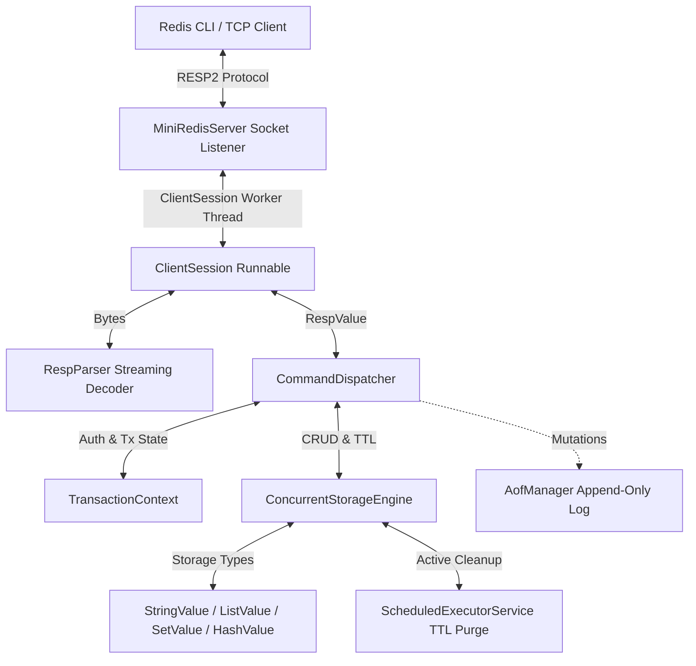

# MiniRedis Architecture

MiniRedis is an educational, production-grade in-memory database built from scratch in Java 21 LTS using the standard Java networking and concurrency primitives without third-party frameworks.

## System Architecture Diagram

## Core Subsystems

### 1. TCP Server & Session Lifecycle
- `MiniRedisServer` binds to a configured host/port with `SO_REUSEADDR`.
- Manages an `ExecutorService` with daemon worker threads.
- Tracks active connections in a thread-safe `Set<Socket>` and atomic client counters.
- Bounded client threshold protects the server from file descriptor exhaustion.

### 2. Streaming RESP2 Protocol Parser
- `RespParser` decodes incoming byte buffers incrementally.
- Supports Simple Strings (`+`), Errors (`-`), Integers (`:`), Bulk Strings (`$`), and Arrays (`*`).
- Handles chunked payloads, pipelined requests, null values, and framing boundaries without blocking.

### 3. In-Memory Concurrent Storage Engine
- `ConcurrentStorageEngine` coordinates key-value operations backed by `ConcurrentHashMap`.
- Per-key atomic updates with `compute()` prevent race conditions.
- Strict type validation returns Redis-compatible `-WRONGTYPE` errors on type mismatch.

### 4. TTL & Key Expiration
- Expiration timestamps stored as millisecond epoch timestamps.
- **Passive Expiration**: Checked on every read/write. Expired keys are lazily evicted and return `null` / `nil`.
- **Active Expiration**: Background scheduled thread periodically samples and purges expired entries.
- Controllable `java.time.Clock` enables deterministic, instantaneous time-travel tests.

### 5. Append-Only File (AOF) Persistence
- Writes successful state-changing commands in binary-safe RESP array format.
- Configurable fsync policies:
  - `always`: Immediate `FileChannel.force(true)` on every write.
  - `everysec`: Background scheduled flush once per second.
  - `no`: Operating system manages file sync buffers.
- Replays valid commands on startup, with resilient handling of truncated crash records.
- Atomic AOF rewrite creates a compacted snapshot and replaces the active file via `ATOMIC_MOVE`.

### 6. Transactions (MULTI / EXEC / DISCARD)
- Isolated per-client `TransactionContext`.
- Commands queued after `MULTI` return `+QUEUED`.
- `EXEC` contiguously executes all queued operations with atomicity guarantees.
